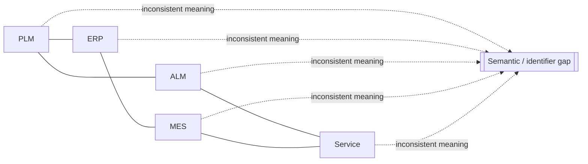

# Current-State Assessment — PP20

## Current business process
Cross-domain questions likely require engineers, manufacturing teams, or analysts to reconcile information from multiple lifecycle systems. Exact workflows must be confirmed.

## Current systems landscape

All named systems above are `assumed` as the relevant integration landscape for blueprinting; confirm actual products, versions, interfaces, regions, owners, and data residency.

## Current data landscape
Likely entities include part/product, requirement, software item, manufacturing operation, serial/vehicle, change, supplier, service event, and evidence. The precise canonical identifiers and relationships are unknown.

## Validation questions
1. Which identifiers are inconsistent across engineering and manufacturing?
2. Which systems are authoritative for each key entity?
3. Where do APIs/events exist today?
4. What data is governed centrally vs by domain?
5. Which single data product would produce measurable value fastest?
