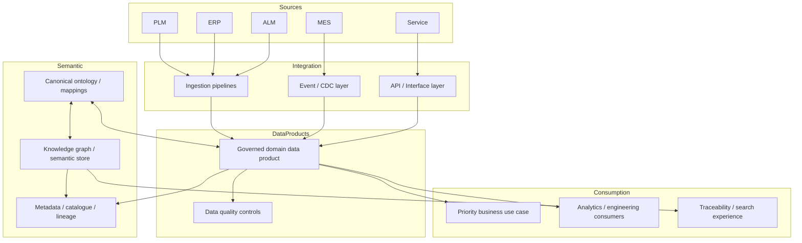

# End-to-End Solution Blueprint — PP20

## Executive recommendation
Start with a **single high-value domain data product** and implement a hybrid semantic integration layer: canonical ontology + governed data product + lineage + API/event interfaces + a graph/semantic store where relationship traversal creates measurable value. Do not attempt an enterprise-wide “data mesh” rollout in the first release.

The blueprint is a design hypothesis, not an OEM-certified target architecture.

## Scope
**In scope:** one domain/product slice; canonical entities required by that use case; source onboarding; semantic mappings; lineage; data quality; reusable interfaces; governance; pilot measurement.

**Out of scope:** enterprise-wide ontology completion; replacing PLM/ERP/MES/ALM; unrestricted source-system writes; full enterprise master-data remediation.

## Recommended solution
The pilot should establish one governed domain data product, backed by a canonical semantic model and reusable integration interfaces, while keeping authoritative source systems unchanged.

## Architecture

## Data flow
1. Extract or receive approved source data/events.
2. Validate schema and source ownership.
3. Map source identifiers to canonical identifiers.
4. Apply data-quality rules.
5. Persist governed representations without changing authoritative source data.
6. Publish lineage, quality status and ownership metadata.
7. Expose the domain data product through governed APIs/events/queries.
8. Measure the pilot use case against a pre-agreed baseline.

## Technology options
| Layer | Candidate families | Selection logic |
|---|---|---|
| Data platform | Databricks, Snowflake, Microsoft Fabric, cloud-native lakehouse | Existing OEM estate, skills, governance, data volumes |
| Semantic/graph | Neo4j, Stardog, Amazon Neptune, RDF/OWL stack | Relationship depth, ontology standards, query needs |
| Eventing | Kafka/Confluent, cloud event buses | Existing event backbone and latency needs |
| API | Azure API Management, Apigee, Kong, cloud-native gateway | Existing integration standard and operating model |
| Catalogue/lineage | Microsoft Purview, Databricks Unity Catalog, Collibra, OpenMetadata | Existing governance and lineage estate |
| Transformation | dbt, Spark, native platform pipelines | Skills and target platform |

**Recommendation:** select from the OEM’s existing strategic platforms first. Introduce a separate graph platform only if the pilot use case demonstrably requires deep relationship traversal that the existing platform cannot serve economically.

## AI/GenAI applicability
AI is **not required to prove the core PP20 architecture**. It is a potential accelerator after the semantic foundation exists—for example, natural-language query, entity resolution assistance, ontology mapping suggestions, or evidence discovery. AI should not become the authoritative source of canonical meaning.

## Build / buy / partner
- **Buy/adopt:** foundational platform capabilities already standard in the OEM estate.
- **Build:** the domain-specific semantic mappings, data products, business rules and experience.
- **Partner:** specialist ontology/data-engineering integration support where internal skills are insufficient.

## Delivery workstreams
| Workstream | Main outputs |
|---|---|
| 1. Pilot framing | use case, baseline, acceptance criteria |
| 2. Data discovery | source inventory, owners, quality baseline |
| 3. Semantic model | canonical entities, mappings, ontology |
| 4. Data product | pipelines, quality, lineage |
| 5. Integration | APIs/events/interfaces |
| 6. Experience | traceability/search or consuming workflow |
| 7. Security/governance | access, audit, controls |
| 8. Value measurement | KPI baseline and pilot results |

## Delivery plan
The work should be delivered as the eight workstreams listed below, with the semantic model and source-access decisions on the critical path.

## Indicative PMO estimate
**Planning hypothesis:** 16–24 weeks to first production-quality pilot, subject to access and existing-platform reuse.

**Indicative team profile:**
- Product/Business Lead: 0.5–1.0 FTE
- Solution/Enterprise Architect: 0.5–1.0 FTE
- Data Architect: 0.5–1.0 FTE
- Data Engineers: 2–4 FTE
- Integration Engineer: 1–2 FTE
- Ontology/Knowledge Engineer: 1–2 FTE
- Security/Governance: 0.25–0.5 FTE
- QA/Test: 0.5–1.0 FTE
- Delivery Manager/PM: 0.5–1.0 FTE

**Effort range:** ~35–60 person-months.

**Budget hypothesis:** use the supplied row’s £500k implementation figure only as a commercial benchmark, not an engineering estimate. A refined estimate requires actual platform/licence costs, access effort, data remediation and internal-vs-partner rates.

## Critical-path assumptions
1. Source access and owner availability.
2. Agreement on the pilot domain and authoritative systems.
3. Baseline data quality sufficient for the use case.
4. Existing strategic platform can host most of the data-product layer.

## Budget
The supplied £500k figure is retained only as the original commercial opportunity benchmark. A project budget should be produced only after discovery, platform selection and resource-rate assumptions are known.

## Deployment
Recommended starting model: **enterprise-managed cloud/hybrid environment aligned with existing OEM platform standards**. Use separate dev/test/prod environments, infrastructure-as-code, policy-controlled access, automated quality gates, and read-back verification after deployment.

## Operating model
Operate the pilot as a managed data product with a named owner, data steward, platform owner and service owner. Monitor freshness, data quality, pipeline failures, semantic mapping exceptions, API/event health and business KPI outcomes.

## Security / privacy / regulatory
Perform threat modelling, data classification, access design, audit logging and retention analysis before production. Specific regulatory applicability depends on the actual data domains and jurisdictions; this blueprint does not attest compliance.

## Risks
- Semantic model becomes too broad before value is proven.
- Source data quality is worse than assumed.
- Ownership of shared concepts cannot be agreed.
- Integration licensing/access slows delivery.
- Graph technology is introduced because it is fashionable rather than because the use case needs it.

## Human decisions required
1. Confirm the pilot business use case and accountable owner.
2. Confirm authoritative systems and data owners.
3. Freeze pilot acceptance criteria.
4. Select the target strategic data platform.
5. Approve the residual risk and pilot budget.

## Recommended next actions
1. Run a 2-week semantic/data discovery sprint.
2. Select one domain data product with measurable baseline.
3. Inventory identifiers, ownership, interfaces and data-quality defects.
4. Produce a pilot-level ontology and data-product design.
5. Re-estimate delivery using real platform/access constraints.
